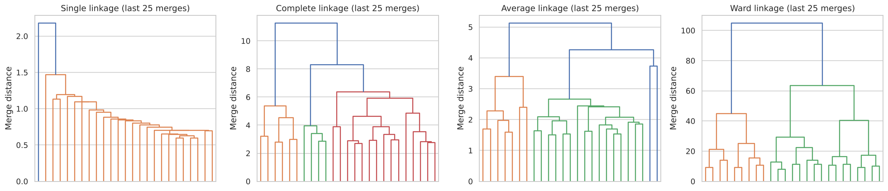
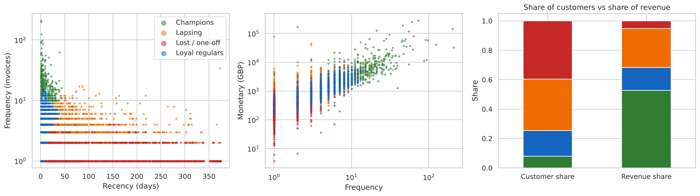

# Customer Segmentation with Hierarchical Clustering (RFM)

Segmenting 4,338 customers of a UK online gift wholesaler by Recency, Frequency and Monetary value using agglomerative hierarchical clustering. Four linkage methods are compared, and the result is cross-checked against K-Means.

   

## Key results

| Segment | Customers | Median recency (days) | Median orders | Median spend (GBP) | Revenue share | Suggested action |
|---|---|---|---|---|---|---|
| **Champions** | 343 (8%) | 9 | 15 | 6,127 | **52.6%** | Account management, retention |
| Loyal regulars | 762 (18%) | 8 | 5 | 1,452 | 15.5% | Cross-sell, grow towards champion |
| Lapsing | 1,517 (35%) | 67 | 3 | 1,021 | 26.6% | Reactivation campaigns |
| Lost / one-off | 1,716 (40%) | 117 | 1 | 252 | 5.2% | Low-cost automated contact only |

| Linkage (log-scaled RFM) | Cluster sizes at k = 4 | Largest share |
|---|---|---|
| Single | 4,333 / 3 / 1 / 1 | 99.9% |
| Complete | 2,467 / 1,820 / 47 / 4 | 56.9% |
| Average | 4,290 / 44 / 3 / 1 | 98.9% |
| **Ward** | **1,716 / 1,517 / 762 / 343** | **39.6%** |

**Findings**

1. **The method choices matter more than the algorithm.** RFM is extremely skewed (monetary skewness 19.3), and single and average linkage chain almost every customer into one cluster. Log-scaling plus Ward linkage is the only setting that produces usable segments.
2. **8% of customers generate 53% of revenue.** The top 5% generate 50%, the top 20% generate 75%.
3. **The Lapsing segment holds 27% of revenue**, which makes it the obvious reactivation target.
4. **Only the Champions segment is robust to the method.** It matches a K-Means cluster almost exactly (340 of 343). Overall agreement with K-Means is moderate (ARI 0.43), so the lower three segments are working divisions of a continuum.

<p align="center">
  <br>
  
</p>

## Getting the data

The raw transaction file is 42 MB, so it is not committed. Download it from the UCI Machine Learning Repository with the included script:

```bash
pip install -r requirements.txt
python scripts/download_data.py      # writes data/OnlineRetail.csv (541,909 rows)
```

The script downloads the official UCI *Online Retail* workbook and converts it to the 7-column CSV layout the notebook expects: StockCode dropped, dates written as `dd-mm-YYYY HH:MM`.

## How to run

```bash
git clone https://github.com/kashiprasadtn/customer-segmentation-hierarchical-clustering.git
cd customer-segmentation-hierarchical-clustering
python -m venv .venv && source .venv/bin/activate   # Windows: .venv\Scripts\activate
pip install -r requirements.txt
python scripts/download_data.py
jupyter lab notebooks/customer_segmentation_hierarchical.ipynb
```

Run all cells (under a minute once the data is downloaded).

## Approach

1. **Cleaning:** drop lines without a CustomerID (24.9%), cancellations, non-positive quantity or price, and duplicates. 392,657 lines remain.
2. **RFM per customer.** Recency is measured from the day after the last transaction.
3. **Skew treatment:** `log1p`, then standardisation. Raw min-max scaling is kept for comparison.
4. **Linkage comparison:** single, complete, average and Ward, scored by cophenetic correlation and cluster sizes.
5. **Choice of k (Ward):** silhouette scores for k = 2 to 8 plus dendrogram merge gaps. k = 4 is chosen for business usefulness, since silhouettes are flat between k = 3 and 5.
6. **Profiling and naming.** Revenue concentration (Pareto) and a K-Means cross-check (ARI).

## Repository structure

```
customer-segmentation-hierarchical-clustering/
├── data/                     # OnlineRetail.csv is downloaded here (git-ignored)
├── scripts/download_data.py  # fetches and converts the UCI dataset
├── notebooks/customer_segmentation_hierarchical.ipynb
├── outputs/figures/   outputs/metrics/
├── reports/Customer_Segmentation_Hierarchical_Report.docx
├── requirements.txt   LICENSE   README.md
```

## Limitations

- One year of transactions from a single, mostly wholesale, UK-based retailer.
- A quarter of transaction lines have no CustomerID and are excluded.
- RFM ignores product mix, margin and returns.
- The choice of four segments is partly a business judgement.

## Data and attribution

- **Dataset:** Chen, D. (2015). *Online Retail* [Dataset]. UCI Machine Learning Repository. https://doi.org/10.24432/C5BW33 (CC BY 4.0).
- The analysis is my own implementation and extends an upGrad hierarchical clustering demo, which is not reproduced here.
- Coursework completed during my MS in Artificial Intelligence (Liverpool John Moores University, delivered via upGrad); published to GitHub in November 2026.

## Licence

Code is released under the [MIT License](LICENSE). The dataset remains under its original CC BY 4.0 licence.
